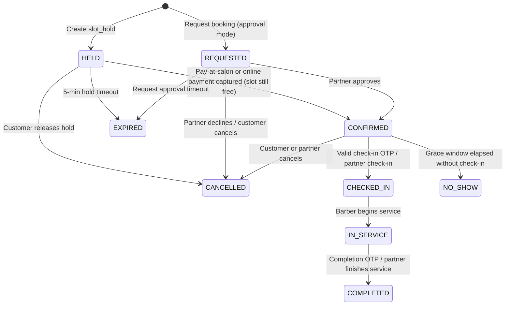

# CHAIR — Database Architecture & Schema Specification

- **Engine:** PostgreSQL 16+ with extensions `pgcrypto`, `postgis`, and `btree_gist`
- **Global Conventions:**
  - Primary keys: `UUID` (`DEFAULT gen_random_uuid()`)
  - Timestamps: `TIMESTAMPTZ` in **UTC** (`created_at`, `updated_at` on every table)
  - Money: `INTEGER` / `BIGINT` in **paise** (`INR`, `100 paise = ₹1`), never floating point
  - Geospatial: `Geography(Point, 4326)` / `Geography(Polygon, 4326)` with `GIST` indexes
  - Soft vs. Hard state: Explicit status enums / `CHECK` constraints validated server-side

---

## 1. Entity Groups (33 Core Entities + 3 Supporting Tables)

### A. Identity, RBAC & Consents
1. **`users`**: `id`, `phone_e164` (unique, indexed), `email`, `full_name`, `preferred_locale` (`en` | `hi`), `is_active`, `last_login_at`
2. **`user_roles`**: `id`, `user_id` -> `users`, `role` (`CUSTOMER`, `PARTNER_OWNER`, `PARTNER_STAFF`, `ADMIN`), `salon_id` (nullable FK), `branch_id` (nullable FK), `granted_by` -> `users`; unique scope constraint preventing duplicate grants
3. **`user_consents`**: `id`, `user_id` -> `users`, `consent_type` (`TERMS`, `PRIVACY_DPDP`, `MARKETING`, `LOCATION`, `STYLE_PASSPORT_PHOTOS`), `version`, `granted` (`bool`), `granted_at`, `revoked_at`, `ip_hash`, `user_agent`

### B. Salons, Branches, Verification & Inspections
4. **`salons`**: `id`, `owner_user_id` -> `users`, `legal_name`, `brand_name`, `gstin`, `pan_masked`, `status` (`DRAFT`, `PENDING_REVIEW`, `ACTIVE`, `SUSPENDED`), `verification_badge_status` (`UNVERIFIED`, `PENDING`, `VERIFIED`, `SUSPENDED`)
5. **`branches`**: `id`, `salon_id` -> `salons`, `zone_id` -> `service_zones` (nullable), `name`, `slug` (unique), `address_line1`, `address_line2`, `city`, `state`, `pincode`, `location` (`Geography(Point, 4326)` + `GIST` index), `operating_hours_json` (structured Mon–Sun open/close windows), `online_booking_paused` (`bool`, default `false`), `is_featured` (`bool`, default `false`), `featured_disclosure_label`, `verification_status` (`UNVERIFIED`, `PENDING`, `CHAIR_VERIFIED`, `ACTION_REQUIRED`, `SUSPENDED`), `status` (`DRAFT`, `ACTIVE`, `CLOSED`, `SUSPENDED`)
6. **`salon_documents`**: `id`, `salon_id` -> `salons`, `branch_id` -> `branches` (nullable), `document_type` (`OWNER_ID`, `BUSINESS_REGISTRATION`, `SHOP_ESTABLISHMENT_LICENSE`, `MUNICIPAL_TRADE_LICENSE`, `ADDRESS_PROOF`, `BANK_PROOF`), `storage_key` (private bucket), `mime_type`, `size_bytes`, `sha256_hex`, `review_status` (`PENDING`, `APPROVED`, `REJECTED`), `rejection_reason`, `reviewed_by` -> `users`, `reviewed_at`
7. **`verification_checks`**: `id`, `salon_id` -> `salons`, `branch_id` -> `branches` (nullable), `check_type` (`IDENTITY`, `BUSINESS`, `ADDRESS`, `LOCAL_LICENSE`, `BANK_PENNY_DROP`, `PHYSICAL_INSPECTION`), `status` (`PENDING`, `PASSED`, `FAILED`, `EXPIRED`), `verified_by` -> `users`, `notes`, `expires_at`
8. **`inspections`**: `id`, `branch_id` -> `branches`, `inspector_user_id` -> `users`, `scheduled_at`, `completed_at`, `numerical_score` (`0..100`), `single_use_blades_ok` (`bool`), `sharps_disposal_ok` (`bool`), `instrument_disinfection_ok` (`bool`), `fresh_towels_ok` (`bool`), `overall_outcome` (`SCHEDULED`, `PASSED`, `CORRECTIVE_ACTION_REQUIRED`, `FAILED_CRITICAL`), `corrective_action_notes`, `reinspection_due_at`, `evidence_keys_json`
   - **Critical Invariant:** If any of the 4 mandatory safety booleans (`single_use_blades_ok`, `sharps_disposal_ok`, `instrument_disinfection_ok`, `fresh_towels_ok`) is `false`, `overall_outcome` MUST be `FAILED_CRITICAL` regardless of `numerical_score`, and `branches.verification_status` is blocked/revoked.

### C. Services, Staff, Shifts & Chairs
9. **`services`**: `id`, `code` (unique), `name_en`, `name_hi`, `category` (`HAIRCUT`, `BEARD`, `SHAVE`, `FACIAL`, `PACKAGE`, `COLOR`), `default_duration_minutes`, `is_active`
10. **`branch_services`**: `id`, `branch_id` -> `branches`, `service_id` -> `services`, `display_name_en`, `display_name_hi`, `description`, `price_paise` (`>= 0`), `duration_minutes` (`> 0`), `buffer_before_minutes` (`>= 0`), `buffer_after_minutes` (`>= 0`), `is_active`; unique `(branch_id, service_id)`
11. **`staff`**: `id`, `branch_id` -> `branches`, `user_id` -> `users` (nullable), `display_name`, `bio`, `specializations_json`, `portfolio_keys_json`, `is_verified_staff` (`bool`), `is_accepting_bookings` (`bool`), `status` (`ACTIVE`, `ON_LEAVE`, `INACTIVE`)
12. **`staff_services`**: `id`, `staff_id` -> `staff`, `branch_service_id` -> `branch_services`, `custom_duration_minutes` (nullable), `is_active`; unique `(staff_id, branch_service_id)`
13. **`staff_shifts`**: `id`, `staff_id` -> `staff`, `branch_id` -> `branches`, `weekday` (`0..6`), `start_time_local` (`TIME`), `end_time_local` (`TIME`), `timezone` (default `'Asia/Kolkata'`), `is_active`
14. **`schedule_blocks`**: `id`, `branch_id` -> `branches`, `staff_id` -> `staff` (nullable -> applies to whole branch if null), `block_type` (`BREAK`, `LEAVE`, `HOLIDAY`, `MAINTENANCE`), `blocked_range` (`TSTZRANGE`), `reason`
15. **`resources`**: `id`, `branch_id` -> `branches`, `name` (e.g., `"Chair 1"`), `resource_type` (`BARBER_CHAIR`, `WASH_STATION`, `VIP_ROOM`), `is_active`

### D. Authoritative Booking Engine & Walk-Ins
16. **`bookings`**: `id`, `booking_code` (unique human code e.g. `CHR-2611-XXXX`), `customer_user_id` -> `users`, `branch_id` -> `branches`, `source` (`PLATFORM`, `WALK_IN`), `booking_mode` (`INSTANT`, `REQUEST`), `status` (`HELD`, `REQUESTED`, `CONFIRMED`, `CHECKED_IN`, `IN_SERVICE`, `COMPLETED`, `CANCELLED`, `EXPIRED`, `NO_SHOW`), `scheduled_start_at`, `scheduled_end_at`, `total_price_paise`, `discount_paise`, `net_payable_paise`, `is_featured_attribution` (`bool`), `check_in_otp_hash`, `completion_otp_hash`, `checked_in_at`, `started_at`, `completed_at`, `cancelled_at`, `cancellation_reason`, `cancelled_by_role`, `notes`
17. **`booking_items`**: `id`, `booking_id` -> `bookings`, `branch_service_id` -> `branch_services`, `service_name_snapshot`, `category_snapshot`, `unit_price_paise_snapshot`, `duration_minutes_snapshot`, `buffer_before_minutes_snapshot`, `buffer_after_minutes_snapshot`, `sort_order`
18. **`booking_allocations`**: `id`, `booking_id` -> `bookings` (nullable if linked to `walk_in_id`), `walk_in_id` -> `walk_ins` (nullable), `branch_id` -> `branches`, `staff_id` -> `staff`, `resource_id` -> `resources` (nullable), `allocated_range` (`TSTZRANGE NOT NULL`), `is_active` (`bool NOT NULL DEFAULT true`)
    - **Exclusion Constraints (`btree_gist`):**
      - `CONSTRAINT uq_active_staff_allocation EXCLUDE USING gist (staff_id WITH =, allocated_range WITH &&) WHERE (is_active)`
      - `CONSTRAINT uq_active_resource_allocation EXCLUDE USING gist (resource_id WITH =, allocated_range WITH &&) WHERE (is_active AND resource_id IS NOT NULL)`
19. **`slot_holds`**: `id`, `customer_user_id` -> `users`, `branch_id` -> `branches`, `staff_id` -> `staff`, `resource_id` -> `resources` (nullable), `hold_range` (`TSTZRANGE NOT NULL`), `expires_at` (`TIMESTAMPTZ NOT NULL`), `status` (`ACTIVE`, `CONVERTED`, `RELEASED`, `EXPIRED`), `idempotency_key`
    - **Exclusion Constraints (`btree_gist`):**
      - `CONSTRAINT uq_active_staff_hold EXCLUDE USING gist (staff_id WITH =, hold_range WITH &&) WHERE (status = 'ACTIVE')`
      - `CONSTRAINT uq_active_resource_hold EXCLUDE USING gist (resource_id WITH =, hold_range WITH &&) WHERE (status = 'ACTIVE' AND resource_id IS NOT NULL)`
20. **`walk_ins`**: `id`, `branch_id` -> `branches`, `staff_id` -> `staff` (nullable), `resource_id` -> `resources` (nullable), `customer_name`, `customer_phone_e164`, `customer_user_id` -> `users` (nullable), `service_summary`, `quoted_price_paise`, `estimated_duration_minutes`, `queue_position`, `status` (`WAITING`, `SEATED`, `IN_SERVICE`, `COMPLETED`, `CANCELLED`, `NO_SHOW`), `checked_in_at`, `completed_at`

### E. Payments, Refunds, Ledger & Subscriptions
21. **`payments`**: `id`, `booking_id` -> `bookings`, `provider` (`PAY_AT_SALON`, `TEST_MODE`, `RAZORPAY`), `provider_order_id`, `provider_payment_id`, `amount_paise`, `currency` (`'INR'`), `status` (`PENDING`, `AUTHORIZED`, `CAPTURED`, `FAILED`, `REFUND_PENDING`, `REFUNDED`, `PAY_AT_SALON`), `paid_at`
22. **`payment_events`**: `id`, `payment_id` -> `payments` (nullable), `provider`, `provider_event_id` (unique `(provider, provider_event_id)` for idempotent webhook processing), `event_type`, `signature_verified` (`bool`), `payload_json`, `processed_at`, `processing_error`
23. **`refunds`**: `id`, `payment_id` -> `payments`, `booking_id` -> `bookings`, `amount_paise`, `reason` (`CUSTOMER_CANCELLED`, `PARTNER_CANCELLED`, `LATE_PAYMENT_HOLD_EXPIRED`, `DISPUTE_RESOLUTION`), `provider_refund_id`, `status` (`PENDING`, `PROCESSED`, `FAILED`), `initiated_by` -> `users`, `processed_at`
24. **`settlements`**: `id`, `salon_id` -> `salons`, `branch_id` -> `branches`, `period_start`, `period_end`, `gross_paise`, `commission_paise`, `tax_tds_paise`, `net_payout_paise`, `payout_reference`, `status` (`PENDING`, `PROCESSING`, `SETTLED`, `FAILED`)
25. **`commission_ledger`**: `id`, `booking_id` -> `bookings` (unique — at most 1 active ledger entry per eligible booking), `salon_id` -> `salons`, `branch_id` -> `branches`, `gross_booking_paise`, `commission_rate_bps` (basis points, e.g. `800` = `8%`, `600` = `6%`, `400` = `4%`), `commission_paise`, `gst_on_commission_paise`, `eligibility_reason`, `status` (`ACCRUED`, `SETTLED`, `REVERSED`), `settlement_id` -> `settlements` (nullable)
26. **`subscriptions`**: `id`, `salon_id` -> `salons`, `branch_id` -> `branches`, `plan_id` -> `subscription_plans`, `status` (`TRIAL`, `ACTIVE`, `PAST_DUE`, `CANCELLED`), `current_period_start`, `current_period_end`, `cancel_at_period_end`
27. **`subscription_invoices`**: `id`, `subscription_id` -> `subscriptions`, `invoice_number` (unique), `subtotal_paise`, `gst_paise`, `total_paise`, `status` (`DRAFT`, `OPEN`, `PAID`, `VOID`), `provider_invoice_id`, `paid_at`

### F. Reviews, Style Passport, Support, Notifications & Audit
28. **`reviews`**: `id`, `booking_id` -> `bookings` (unique — strictly one review per `COMPLETED` booking), `customer_user_id` -> `users`, `branch_id` -> `branches`, `staff_id` -> `staff` (nullable), `rating` (`1..5`), `hygiene_rating` (`1..5`), `comment`, `is_published`
29. **`style_profiles`**: `id`, `user_id` -> `users` (unique), `preferred_length`, `fade_style`, `beard_style`, `skin_sensitivity_notes`, `barber_notes`, `share_with_booked_barber` (`bool`)
30. **`style_photos`**: `id`, `style_profile_id` -> `style_profiles`, `user_id` -> `users`, `storage_key` (private bucket), `mime_type`, `size_bytes`, `angle_label` (`FRONT`, `LEFT`, `RIGHT`, `BACK`), `taken_at`, `consent_id` -> `user_consents`, `retention_expires_at`
31. **`support_cases`**: `id`, `case_number` (unique), `reporter_user_id` -> `users`, `booking_id` -> `bookings` (nullable), `branch_id` -> `branches` (nullable), `category` (`BOOKING_ISSUE`, `HYGIENE_CONCERN`, `PAYMENT_REFUND`, `PARTNER_DISPUTE`, `OTHER`), `priority` (`LOW`, `MEDIUM`, `HIGH`, `CRITICAL`), `status` (`OPEN`, `IN_REVIEW`, `ACTION_TAKEN`, `RESOLVED`, `CLOSED`), `assigned_admin_id` -> `users` (nullable), `resolution_notes`
32. **`notifications`**: `id`, `user_id` -> `users`, `channel` (`PUSH`, `SMS`, `EMAIL`, `IN_APP`), `template_key`, `payload_json`, `status` (`QUEUED`, `SENT`, `FAILED`, `READ`), `sent_at`, `read_at`
33. **`audit_logs`**: `id`, `actor_user_id` -> `users` (nullable for system), `actor_role`, `action`, `resource_type`, `resource_id`, `branch_id` (nullable), `before_state_json`, `after_state_json`, `request_id`, `ip_address`, `created_at` (append-only)

### G. Supporting Operational Tables
34. **`service_zones`**: `id`, `city`, `name`, `boundary` (`Geography(Polygon, 4326)`), `center` (`Geography(Point, 4326)`), `is_active`
35. **`subscription_plans`**: `id`, `code` (`STARTER`, `PRO`, `GROWTH`), `name`, `monthly_price_paise` (`0`, `49900`, `99900`), `commission_rate_bps` (`800`, `600`, `400`), `is_active`
36. **`idempotency_keys`**: `id`, `actor_key`, `endpoint`, `idempotency_key`, `request_hash`, `response_status`, `response_body_json`, `expires_at` (unique `(actor_key, endpoint, idempotency_key)`)

---

## 2. Authoritative Booking State Machine

- Terminal states: `COMPLETED`, `CANCELLED`, `EXPIRED`, `NO_SHOW`.
- Only `COMPLETED` + `source = 'PLATFORM'` bookings generate `commission_ledger` accruals and qualify for `reviews`.
